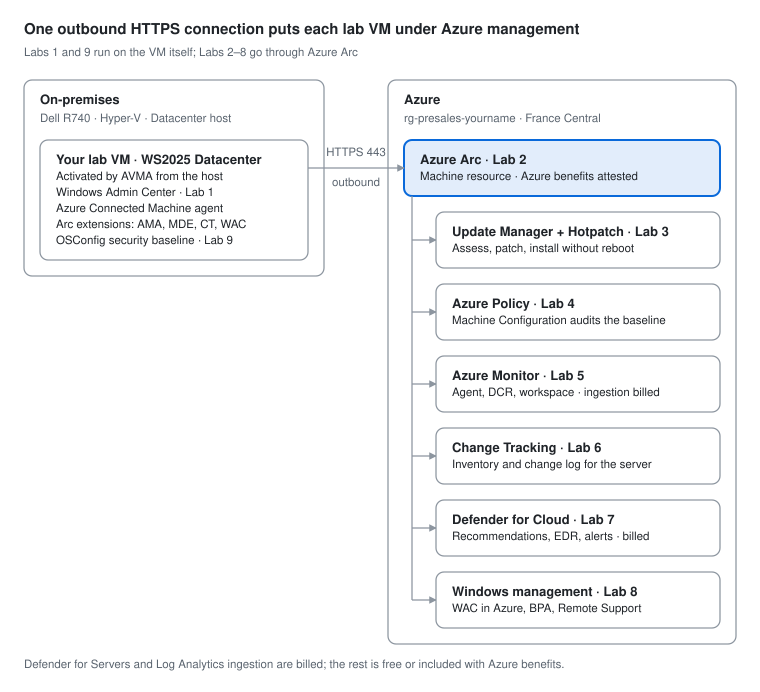

# Windows Server 2025 Hybrid Labs

Hands-on labs for presales engineers: Windows Server 2025 on-premises, managed from Azure with Azure Arc. One VM per person, nine labs, each ending with customer talking points.

Nine labs, one VM each, about 8 hours — plan two days. Labs 2–8 are the **hybrid** track with Azure Arc; Labs 1 and 9 cover Windows Server 2025 on its own. Every lab ends with **customer talking points**, because the goal is not just to click through — it's to answer the customer's question in the meeting.

> **New to Windows Server?** Start with **[Level 100: Foundations](foundations/README.md)**: five 30-minute labs on editions, licensing, roles, admin tools and storage. These hybrid labs are Level 200.

So what do you get? Each presales engineer has their own **Windows Server 2025 Datacenter (Desktop Experience)** VM on our Dell R740 Hyper-V host. It's already activated, has Remote Desktop on, and has internet access.

| Lab | What you'll be able to show a customer | Time | Azure cost |
| --- | --- | --- | --- |
| [1. Windows Admin Center](labs/01-windows-admin-center.md) | Browser-based management of a server | 45 min | None |
| [2. Azure Arc onboarding and Azure benefits](labs/02-azure-arc-onboarding-and-azure-benefits.md) | An on-premises server in the Azure portal, and the SA benefits unlocked | 75 min | Free |
| [3. Hotpatching with Azure Arc](labs/03-hotpatching-with-azure-arc.md) | Security updates without a reboot | 45 min | Free |
| [4. Azure Policy and Machine Configuration](labs/04-azure-policy-and-machine-configuration.md) | Compliance of every server from one dashboard | 45 min + 30 min wait | Included with benefits |
| [5. Azure Monitor](labs/05-azure-monitor.md) | Performance, event logs and alerts for hybrid servers | 60 min | Log ingestion billed |
| [6. Change Tracking and Inventory](labs/06-change-tracking-and-inventory.md) | "What changed on this server last night?" | 45 min | Included; ingestion billed |
| [7. Microsoft Defender for Cloud](labs/07-microsoft-defender-for-cloud.md) | Recommendations, secure score, EDR and alerts | 60 min | Defender for Servers billed (30-day trial) |
| [8. Windows management from Azure](labs/08-windows-management-from-azure.md) | WAC in the portal with no VPN, Best Practices Assessment, Remote Support | 60 min | Included; ingestion billed |
| [9. Security baseline with OSConfig](labs/09-security-baseline-with-osconfig.md) | Secure-by-default: harden in one command, then see compliance rise in Azure | 45 min | None |

**What you need:**

- RDP access to your VM (name and password from your lab admin).
- From Lab 2: an Azure subscription where you can create a resource group (**Contributor**). The instructor handles the steps that need more rights: the Azure benefits attestation (Lab 2), Defender for Servers (Lab 7) and role assignments (Lab 8).
- Do the labs in order. Labs 6 and 8 reuse the workspace from Lab 5.



The Arc agent opens one outbound HTTPS connection on port 443; every Azure service in Labs 2–8 reaches the VM through it, with no inbound port open on the server.

When something breaks, don't worry. Your VM can be rebuilt in a few minutes — see [Cleanup and reset](labs/cleanup-and-reset.md).

## Labs

1. [Windows Admin Center (45 min)](labs/01-windows-admin-center.md)
2. [Azure Arc onboarding and Azure benefits (75 min)](labs/02-azure-arc-onboarding-and-azure-benefits.md)
3. [Hotpatching with Azure Arc (45 min)](labs/03-hotpatching-with-azure-arc.md)
4. [Azure Policy and Machine Configuration (45 min + 30 min wait)](labs/04-azure-policy-and-machine-configuration.md)
5. [Azure Monitor (60 min)](labs/05-azure-monitor.md)
6. [Change Tracking and Inventory (45 min)](labs/06-change-tracking-and-inventory.md)
7. [Microsoft Defender for Cloud (60 min)](labs/07-microsoft-defender-for-cloud.md)
8. [Windows management from Azure (60 min + up to 4 h for the first assessment)](labs/08-windows-management-from-azure.md)
9. [Security baseline with OSConfig (45 min)](labs/09-security-baseline-with-osconfig.md)
10. [Cleanup and reset](labs/cleanup-and-reset.md)

## Lab environment (instructor)

The `scripts` folder builds the lab on a Hyper-V host running **Windows Server 2025 Datacenter** (activated — the VMs activate against it with AVMA). Run in an elevated PowerShell session on the host.

| Script | What it does |
| --- | --- |
| [`New-WS2025LabVMs.ps1`](scripts/New-WS2025LabVMs.ps1) | Builds a template VHDX from the Windows Server 2025 ISO (once), then creates the lab VMs as Gen 2 VMs with Secure Boot and vTPM, injects an unattend.xml with the AVMA key, and checks activation. Skips VMs that already exist. |
| [`Remove-LabVM.ps1`](scripts/Remove-LabVM.ps1) | Deletes a VM and all its files (disks, checkpoints, folder). Never deletes the template or disks used by other VMs. Supports `-WhatIf`. |

```powershell
Unblock-File .\scripts\*.ps1
.\scripts\New-WS2025LabVMs.ps1 -VMCount 8                    # build the template + 8 VMs
.\scripts\Remove-LabVM.ps1 -Name WS25-VM03 -WhatIf          # dry run
.\scripts\Remove-LabVM.ps1 -Name WS25-VM03                  # delete one VM
```

Default ISO path, VM folder, memory and network settings are parameters at the top of `New-WS2025LabVMs.ps1`.

## Sources

- [Install Windows Admin Center](https://learn.microsoft.com/windows-server/manage/windows-admin-center/deploy/install)
- [Deploy Windows Server 2025 security baselines locally with OSConfig](https://learn.microsoft.com/en-us/windows-server/security/osconfig/osconfig-how-to-configure-security-baselines)
- [Quickstart: Connect a machine to Arc-enabled servers](https://learn.microsoft.com/azure/azure-arc/servers/quick-enable-hybrid-vm)
- [Windows Server Management enabled by Azure Arc](https://learn.microsoft.com/azure/azure-arc/servers/windows-server-management-overview?tabs=portal)
- [Enable Hotpatch for Azure Arc-enabled servers](https://learn.microsoft.com/en-us/windows-server/get-started/enable-hotpatch-azure-arc-enabled-servers)
- [Manage hotpatches on Arc-enabled machines](https://learn.microsoft.com/azure/update-manager/manage-hot-patching-arc-machines)
- [Discover and assign built-in Machine Configuration policies](https://learn.microsoft.com/azure/governance/machine-configuration/how-to/assign-built-in-policies)
- [Windows security baseline for Windows Server 2025 (Azure Policy)](https://learn.microsoft.com/azure/governance/policy/samples/guest-configuration-baseline-windows-server-2025)
- [Tutorial: Monitor a hybrid machine with VM insights](https://learn.microsoft.com/azure/azure-arc/servers/tutorial-enable-vm-insights)
- [Quickstart: Enable Change Tracking and Inventory](https://learn.microsoft.com/azure/azure-change-tracking-inventory/quickstart-monitor-changes-collect-inventory-azure-change-tracking-inventory)
- [Protect your servers with Defender for Servers](https://learn.microsoft.com/azure/defender-for-cloud/tutorial-enable-servers-plan)
- [Validate alerts in Microsoft Defender for Cloud](https://learn.microsoft.com/azure/defender-for-cloud/alert-validation)
- [Manage Azure Arc-enabled servers using Windows Admin Center in Azure](https://learn.microsoft.com/windows-server/manage/windows-admin-center/azure/manage-arc-hybrid-machines)
- [Configure Best Practices Assessment for Arc-enabled Windows servers](https://learn.microsoft.com/windows-server/manage/azure-arc/best-practices-assessment-for-windows-server)
